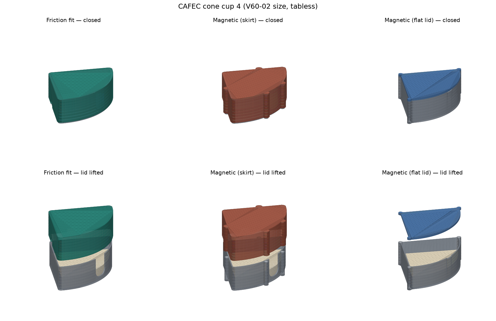
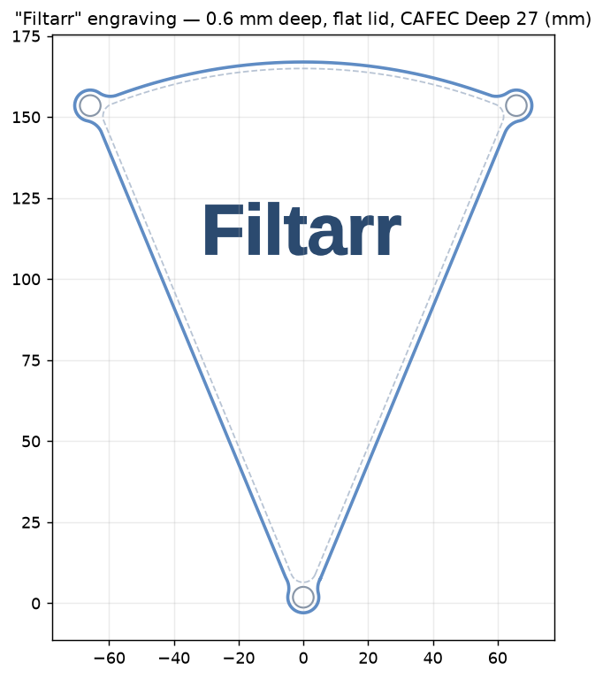

# Filtarr

3D-printable, dust-proof storage boxes for **pour-over paper filters** — currently
five papers (CAFEC Deep 27, Hario/CAFEC V60 sizes 01 & 02, and compact tabless CAFEC
cone variants) in three case designs, each with an optional engraved lid. Everything
is generated from one parametric Python script; adding a new paper is one registry
entry ([HOWTO](HOWTO.md)).

**Browse the interactive 3D previews and download STLs at
[ardakilic.github.io/filtarr](https://ardakilic.github.io/filtarr/).**

Open filter stands collect dust and kitchen odours; the original pouches are annoying
to use. Filtarr cases are two-piece wedge boxes: a tray that holds a full 100-pack
lying flat, plus a lid.


*CAFEC Deep 27 cases in all three designs — see the [gallery](#gallery) for the V60
variants.*

## Supported papers

| Paper | Flat geometry | Designs | Largest part |
|---|---|---|---|
| CAFEC Deep 27 (Abaca+) — [`deep27/`](deep27/) | 42° wedge, 155 mm side, no tab | all 3 | 172 × 142 mm |
| V60 size 01 (Hario / CAFEC) — [`v60/`](v60/) | 90° wedge, ≤107 mm seam edge + tab | all 3 | 128 × 187 mm |
| V60 size 02 (Hario / CAFEC) — [`v60/`](v60/) | 90° wedge, ≤128 mm seam edge + tab | all 3 | 150 × 219 mm |
| CAFEC cone cup 1, tabless — [`v60/`](v60/) | 90° wedge, 106 mm seam edge, no tab | all 3 | 121 × 176 mm |
| CAFEC cone cup 4, tabless — [`v60/`](v60/) | 90° wedge, 127 mm seam edge, no tab | all 3 | 142 × 207 mm |

The V60 boxes add radial clearance for the little **hanging tab** on the arc edge;
since its position varies by brand (Hario, CAFEC, generics), the whole interior is
enlarged radially — **one box fits all brands**. If you only use tabless CAFEC cone
papers, the dedicated `v60-cafec-*` cases are more compact (cup 4's friction design
fits a 200 mm bed where the all-brands V60-02 needs 220).

Every base holds a **full 100-pack lying loose, never squeezed** — interior depths
are sized per paper from measured stack heights: smooth Hario paper stacks ~32 mm
per 100, so those cases are 42 mm deep; creped CAFEC paper barely compresses (a
100-stack stays close to its 40–50 mm pouch thickness), so Deep 27 and cup 1 get
47 mm and cup 4 gets 54 mm, with headroom because papers fluff up once opened.
Tip: the crimped seam makes a stack lean taller on one side — flipping half the
papers upside down balances the pile (the wedge is symmetric).

## The three designs

| | Friction fit | Magnetic (skirt) | Magnetic (flat lid) |
|---|---|---|---|
| Lid style | full-cover telescoping lid | full-cover telescoping lid | flat lay-on lid, MAG-BOX style |
| Closure | snug fit (0.28 mm/side) | loose glide + 4 magnet pairs | 3 magnet pairs in the corners |
| Magnets needed | none | 8× Ø6 × 3 mm | 6× Ø6 × 3 mm |
| Paper access | finger scoop in the wide-end wall | finger scoop in the wide-end wall | whole top opens; pry slot under the lid edge |
| Character | no hardware at all | most dust-proof magnetic option | simplest, lightest lid, one-hand open |

Shared features: finger scoop (telescoping designs) reaching to 8 mm above the floor,
fully covered when closed; grip notches and a 3 mm exposed base rim so the telescoping
halves separate easily; an alignment lip on the flat lid so it can't slide sideways;
no supports needed in the exported print orientation.

## Gallery

**V60 size 01 (Hario / CAFEC)** — fits all brands, tab included —
[interactive preview](https://ardakilic.github.io/filtarr/v60/preview-01.html)


**V60 size 02 (Hario / CAFEC)** — fits all brands, tab included —
[interactive preview](https://ardakilic.github.io/filtarr/v60/preview-02.html)


**CAFEC cone cup 1, tabless** — compact —
[interactive preview](https://ardakilic.github.io/filtarr/v60/preview-cafec-01.html)


**CAFEC cone cup 4, tabless** — compact —
[interactive preview](https://ardakilic.github.io/filtarr/v60/preview-cafec-02.html)



## The "Filtarr" engraving

Every design has a second lid STL with **"Filtarr"** engraved 0.6 mm into the top face
(60 mm wide, Arial-style bold), upright when the tip of the wedge points at you. Text,
size, depth, font and position are parameters in `generate.py`.



## Interactive previews

Online at **[ardakilic.github.io/filtarr](https://ardakilic.github.io/filtarr/)**
(republished automatically on every push to `main`), or locally — each preview is a
fully self-contained HTML file (no internet needed), open in any browser:

- [`deep27/preview.html`](deep27/preview.html)
- [`v60/preview-01.html`](v60/preview-01.html)
- [`v60/preview-02.html`](v60/preview-02.html)
- [`v60/preview-cafec-01.html`](v60/preview-cafec-01.html)
- [`v60/preview-cafec-02.html`](v60/preview-cafec-02.html)

Switch between the designs, toggle the engraving, lift the lid with the slider, and
turn on X-ray or the ghost paper stack (which includes the V60 tab). The **"Print
these two"** panel always names the exact STL files (and magnet count) for what you're
looking at, and "← All papers" returns to the index.

## Files

Per design: 3 STLs (base + plain lid + engraved lid). Pick one base and one lid from
the same design:

```
<folder>/stl/<paper>-case-friction-{base,lid,lid-engraved}.stl
<folder>/stl/<paper>-case-magnet-skirt-{base,lid,lid-engraved}.stl
<folder>/stl/<paper>-case-magnet-flat-{base,lid,lid-engraved}.stl
```

## Printing

- **Bed size**: see the supported-papers table. Deep 27 and CAFEC cup 1 fit
  180 × 180 mm beds; V60-01 needs ~190 mm in one axis (its friction design fits 180);
  CAFEC cup 4 needs ~200 mm (friction/skirt) to ~210 mm (flat lid); the all-brands
  V60-02 needs a 220 mm bed.
- **Material**: PLA or PETG, 0.4 mm nozzle, 0.2 mm layers, 3 perimeters, 10–15 % infill.
- **Warping**: large flat parts — use a brim or good bed adhesion, especially PETG.
- No supports. Lids print top-face-down: smooth first-layer finish, crisp engraving,
  and magnet pockets become open blind holes.

### Fit tuning (friction design)

Printers vary. If the friction lid is too tight or too loose, either scale the **lid
only** by ∓0.2 % in XY in your slicer, or change `CLEAR_FRICTION` in `generate.py` and
regenerate. Both magnetic designs are tolerance-forgiving by design.

## Magnet assembly (both magnetic designs)

Magnets: **Ø6 mm × 3 mm** discs (N35 or stronger) — 8 for the skirt design, 6 for the
flat design. Pockets are Ø6.4 × 3.2 mm, so each magnet sits ~0.2 mm recessed — facing
pairs never touch, giving a gentle snap that opens with one hand.

Get the polarity right on the first try:

1. Glue the base-side magnets into the **base** pockets (a drop of superglue or epoxy
   per pocket; press flush). Orientation of each individual magnet does not matter yet.
2. Once cured, place the remaining magnets **on top of the glued ones** — they snap on
   in the correct orientation by themselves.
3. Put a drop of glue in each **lid** pocket, align the lid, and press it fully closed.
   The loose magnets seat into the lid pockets in the right polarity. Let it cure
   closed (superglue: use sparingly — fumes can leave white residue; gel superglue or
   5-minute epoxy is cleaner).

## Regenerating / customizing

Everything runs inside Docker (`python:3-slim`) — no local Python needed, just
Docker and make:

```bash
make              # everything: STLs + previews + index + README images
make generate     # STLs + preview HTMLs + index.html
make docs         # README images (<folder>/docs/*.png)
make vendor       # fetch the latest three.js build (two files) into vendor/
make image        # (re)build the Docker build image only
make clean        # delete all generated outputs
```

(Without Docker: `pip install -r requirements.txt && python3 generate.py` works too.)

Add a new paper: see **[HOWTO.md](HOWTO.md)**. Useful shared knobs at the top of
`generate.py`:

| Parameter | Default | Meaning |
|---|---|---|
| `PAPERS` | 5 entries | the paper registry (side / angle / tab clearance / designs) |
| `DEPTH` / per-paper `depth` | 42 / 47 / 54 mm | interior depth — 42 default (Hario), deeper for creped CAFEC papers |
| `CLEAR_FRICTION` / `CLEAR_MAGNET` | 0.28 / 0.50 mm | lid clearance per side |
| `POCKET_D` / `POCKET_DEPTH` | 6.4 / 3.2 mm | magnet pocket (for Ø6 × 3 magnets) |
| `ENGRAVE_TEXT` / `ENGRAVE_WIDTH` / `ENGRAVE_DEPTH` | "Filtarr" / 60 / 0.6 mm | lid engraving |
| `SCOOP_W` | 36 mm | finger scoop width |

The engraving font comes from `FONT_CANDIDATES`: Arial Bold where available, and
Liberation Sans Bold (the metric-compatible Arial substitute installed in the Docker
build image) otherwise.

## Paper geometry (verified)

- A cone dripper with full apex angle **A** uses paper that unrolls to a
  `360·sin(A/2)`° sector, folding flat into a `180·sin(A/2)`° wedge.
- **Deep 27**: 27° cone → **42° wedge** (photo-confirmed 42.7° ± 1°); side ~155 mm;
  arc wide end of R≈155 about the tip; ~8 mm crimped seam; no tab; sold as 100-packs
  in a 205 × 160 × 40 mm pouch → loose stack 30–40 mm
  ([CAFEC official](https://cafec-jp.com/products/deep27/)).
- **V60**: 60° cone → **90° wedge**. Size 02: Hario's official flat sheet spec is
  125 × 125 mm ([maker data](https://www.askul.co.jp/p/EK20953/)); independently
  measured up to 125 × 128 mm. Size 01: spec 100 × 100 mm, measured up to
  105 × 107 mm. Hario papers carry a **hanging tab** (~15 mm wide, protruding
  ~5–7 mm) on the arc edge next to the seam corner; CAFEC cone papers
  ([same footprint](https://thebasicbarista.com/en-us/products/cafec-abaca-filter-papers))
  have no tab; generic clones vary — the cases size for the largest case
  (Hario + tab), so all brands fit.
- **100-pack stack heights** (they drive the interior depths): a single ply
  measures 206–210 µm ([caliper data](https://coffeeadastra.com/2019/08/04/an-in-depth-analysis-of-coffee-filters-2/))
  and a folded filter is two plies. Smooth Hario paper nests: ~32 mm per 100
  (measured). CAFEC's one-sided crepe doesn't: a 100-stack stays near its pouch
  thickness — 40 mm for Deep 27 and cup 1, 50 mm for cup 4.

## Design notes & credits

Ideas borrowed from the V60 3D-printing community: closed boxes beat open stands for
dust/odour (r/pourover consensus), finger cutouts at the paper edge
([packydb's drawer tray](https://www.thingiverse.com/thing:4980450)), corner-magnet
flat lids (the classic MAG-BOX pattern), glued 6 mm disc magnets in recesses
([AeroPress filter holder](https://www.printables.com/model/814937-aeropress-filter-holder)),
and generous cavity margins — V60 boxes repeatedly needed scaling because paper sizes
vary between brands and batches. Possible future ideas: a lifting platform for the last
few papers ([AeroPress filter case](https://www.printables.com/model/307459-aeropress-filter-case)),
a sloped floor, a wall-mount plate.

## License

Dual-licensed:

- **Code** (generator, templates, tooling): [MIT](LICENSE)
- **Models & images** (STLs, previews, renders): [CC BY 4.0](LICENSE-MODELS) — use,
  share, sell and remix freely, but credit **Filtarr** with a link back when you
  redistribute the models.
