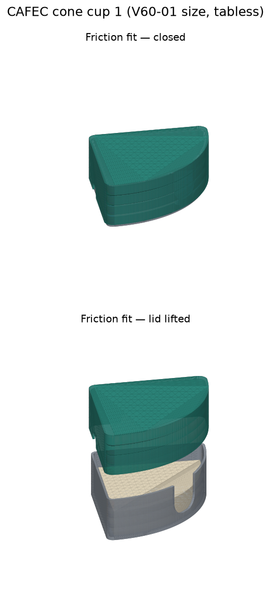
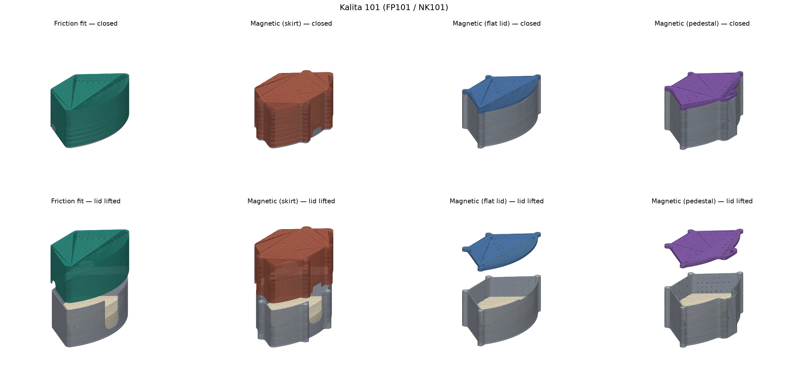
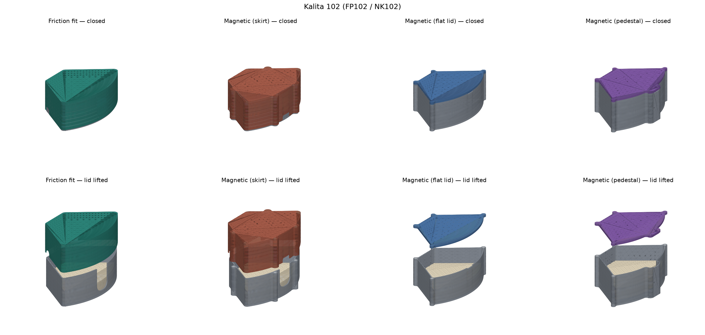
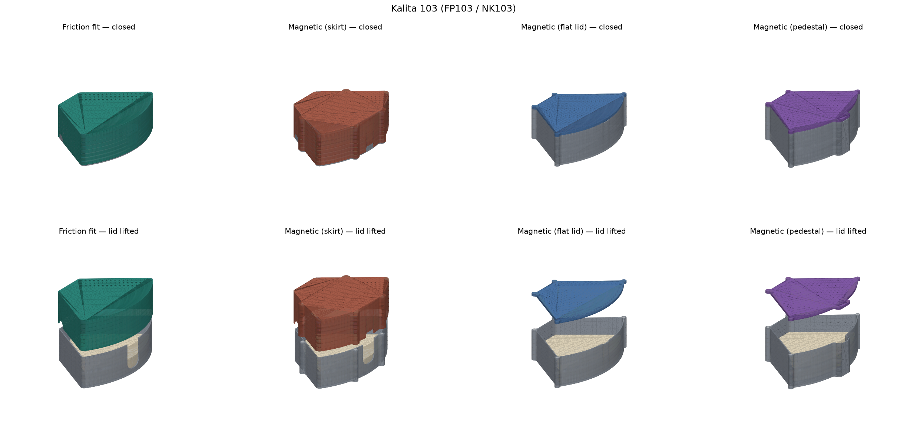
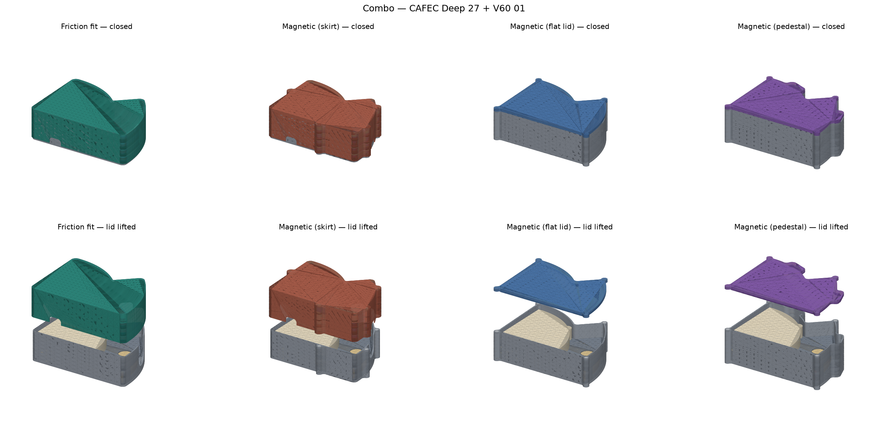
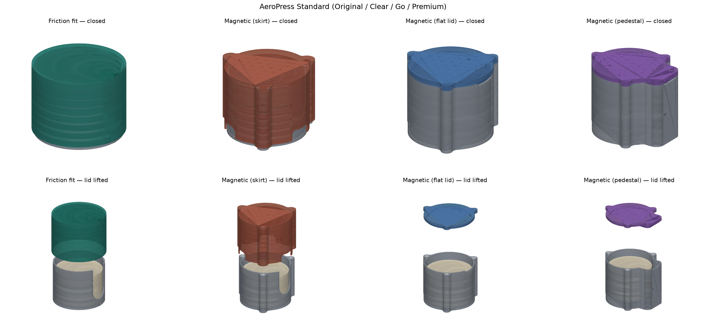
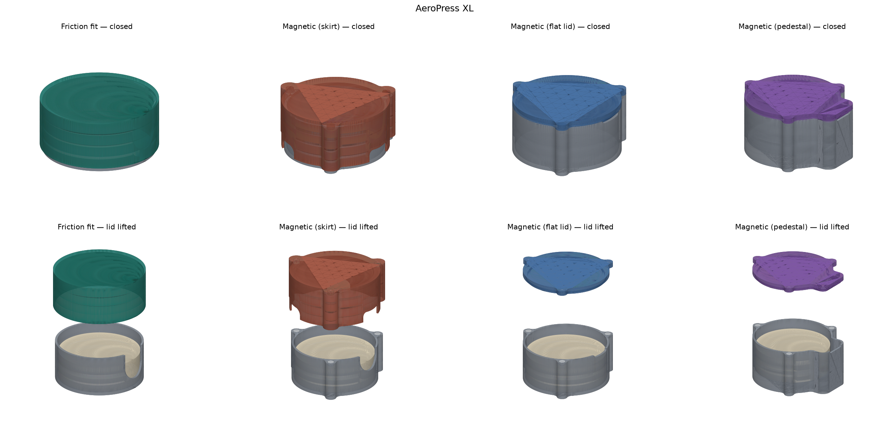

# Filtarr

3D-printable, dust-proof storage boxes for **pour-over paper filters** — currently
ten papers in three shapes: cone papers in wedge boxes (CAFEC Deep 27, Hario/CAFEC
V60 sizes 01 & 02, and compact tabless CAFEC cone variants), Kalita 101 / 102 / 103
flat-bottom fan papers, and AeroPress Standard and XL paper discs in round boxes —
plus a two-paper [combo box](#combo-box-two-papers-one-case), in four case designs,
each with an optional engraved lid. Everything is generated from one parametric
Python script; adding a new paper is one registry entry ([HOWTO](HOWTO.md)).

**Browse the interactive 3D previews and download STLs at
[ardakilic.github.io/filtarr](https://ardakilic.github.io/filtarr/).**

Open filter stands collect dust and kitchen odours; the original pouches are annoying
to use. Filtarr cases are two-piece boxes shaped like the paper they hold — a wedge,
a flat-bottomed fan or a circle: a tray that holds a full pack lying flat, plus a
lid.


*CAFEC Deep 27 cases in all four designs — see the [gallery](#gallery) for the V60
variants.*

## Supported papers

| Paper | Flat geometry | Designs | Largest part |
|---|---|---|---|
| CAFEC Deep 27 (Abaca+) — [`deep27/`](deep27/) | 42° wedge, 155 mm side, no tab | all 4 | 182 × 142 mm |
| V60 size 01 (Hario / CAFEC) — [`v60/`](v60/) | 90° wedge, ≤107 mm seam edge + tab | all 4 | 140 × 187 mm |
| V60 size 02 (Hario / CAFEC) — [`v60/`](v60/) | 90° wedge, ≤128 mm seam edge + tab | all 4 | 162 × 219 mm |
| CAFEC cone cup 1, tabless — [`v60/`](v60/) | 90° wedge, 106 mm seam edge, no tab | all 4 | 133 × 177 mm |
| CAFEC cone cup 4, tabless — [`v60/`](v60/) | 90° wedge, 127 mm seam edge, no tab | all 4 | 154 × 207 mm |
| Kalita 101 (FP101 / NK101) — [`kalita/`](kalita/) | 73° flat-bottom fan, 134–138 × 80 mm, 45–55 mm bottom, no tab | all 4 | 107 × 166 mm |
| Kalita 102 (FP102 / NK102) — [`kalita/`](kalita/) | 71° flat-bottom fan, 160–165 × 100–105 mm, 44–54 mm bottom, no tab | all 4 | 131 × 193 mm |
| Kalita 103 (FP103 / NK103) — [`kalita/`](kalita/) | 70° flat-bottom fan, 193–200 × 127–130 mm, 47–56 mm bottom, no tab | all 4 | 156 × 223 mm |
| **Combo**: CAFEC Deep 27 + V60 size 01 — [`combo/`](combo/) | both wedges above, overlaid against one shared wall | all 4 + optional dividers | 192 × 135 mm |
| AeroPress Standard (Original / Clear / Go / Premium) — [`aeropress/`](aeropress/) | Ø63.5 mm discs (box takes up to Ø65) | all 4 | 90 × 75 mm |
| AeroPress XL — [`aeropress/`](aeropress/) | Ø73.7 mm discs (box takes up to Ø75) | all 4 | 100 × 84 mm |

The V60 boxes add radial clearance for the little **hanging tab** on the arc edge;
since its position varies by brand (Hario, CAFEC, generics), the whole interior is
enlarged radially — **one box fits all brands**. If you only use tabless CAFEC cone
papers, the dedicated `v60-cafec-*` cases are more compact (cup 4's friction design
fits a 200 mm bed where the all-brands V60-02 needs 220).

**Kalita fan papers** — FP101 / FP102 / FP103 and the lighter NK101–103 (101 = 1–2
cups, 102 = 2–4, 103 = 4–7). Fan sizes vary between brands and batches, so each
size lists several real sheets (chord × centre height × bottom edge; the ranges in
the table): one reference sheet sets the box's fan angle, and the box is sized so
that **every listed sheet** fits — some are larger than the reference in one
dimension (a wider bottom, a longer chord) — and `make verify` seats each one. For
the 102 box the list includes **Melitta 1x2** (160 × 105 mm, 47 mm bottom) and
**Brooks 102** (165 × 103 mm, 54 mm bottom). By overall size, Kalita 101 / 103 are
the same classes as Melitta 1x1 / 1x4 (US #4) — but those pairings are by overall
size only: their bottom widths and angles are unverified. Kalita *Wave* papers are
pre-formed cups, not flat fans, and don't go in these boxes.

**AeroPress discs** — the Standard box takes the filters of every standard-size
AeroPress (Original, Clear, Go, Premium: official Ø63.5 mm micro-filters; sized for
discs up to Ø65), one 350-pack. Third-party discs fit too: Aesir (twice as thick —
about 215–240 of them), CAFEC, generic 6.4 cm discs, and Ø61–63.5 mm metal discs.
The XL box takes one 200-pack of AeroPress XL filters (Ø73.7 mm).

**Researched, not boxed yet** — see [RESEARCH.md](RESEARCH.md), which also records
the sources behind every number above. **Origami** cone papers need no new footprint:
Cup2 / Cup4 fit the tabless CAFEC boxes (`v60-cafec-01` / `-02`; the all-brands V60
boxes are too shallow for Origami's non-nesting crepe). Capacity is another matter:
their 47 / 54 mm depths hold a CAFEC-pouch-size stack, but not the worst-case 50 mm
(Cup2) / 55 mm (Cup4) 100-stack without squeezing — store fewer sheets, or build a
deeper copy of the entry with a larger `depth` (see [HOWTO.md](HOWTO.md)). **Kalita Wave** 155 / 185, Kalita 104 and
**drip-machine papers** (Melitta-style cones, US basket filters) are researched and
get their boxes in a follow-up.

Every base holds a **full 100-pack lying loose, never squeezed** — interior depths
are sized per paper from measured stack heights: smooth Hario paper stacks ~32 mm
per 100, so those cases are 42 mm deep; creped CAFEC paper barely compresses (a
100-stack stays close to its 40–50 mm pouch thickness), so Deep 27 and cup 1 get
47 mm and cup 4 gets 54 mm, with headroom because papers fluff up once opened.
The Kalita boxes are 58 mm deep, sized for Kalita's bagged 100-packs (40–50 mm
thick). That depth doesn't count the flat and pedestal lids'
2.5 mm alignment lip: along the walls — where the sheets' crimped bottom edge lies —
those lids leave 55.5 mm, still more than 5 mm above a 50 mm bag stack (58 everywhere
else, and on the telescoping designs). Kalita's boxed 珈琲屋さん line (≈ 57–58 mm
per 100, estimated from its box, low confidence) isn't guaranteed to fit unsqueezed. The AeroPress depths do include the lip: they
hold a whole pack — 55 mm for a 350-pack, 35 mm for an XL 200-pack (worst-case stack
plus the flat lid's lip, which in a close round bore comes down over the disc edges).
The pedestal design adds its 8 mm pedestal *on top* of these depths, so its box is
8 mm taller and the headroom is unchanged.
Tip: the crimped seam makes a stack lean taller on one side — flipping half the
papers upside down balances the pile (wedges and fans are symmetric).

## The four designs

| | Friction fit | Magnetic (skirt) | Magnetic (flat lid) | Magnetic (pedestal) |
|---|---|---|---|---|
| Lid style | full-cover telescoping lid | full-cover telescoping lid | flat lay-on lid, MAG-BOX style | flat lay-on lid, MAG-BOX style |
| Closure | snug fit (0.28 mm/side); round boxes: twist-off | loose glide + 4 magnet pairs (round boxes: 3) | a magnet pair per corner: 3 (Kalita and combo boxes: 4; round boxes: 3 bulges) | a magnet pair per corner: 3 (Kalita and combo boxes: 4; round boxes: 3 bulges) |
| Magnets needed | none | 8× Ø6 × 3 mm (round boxes: 6×) | 6× Ø6 × 3 mm (Kalita and combo boxes: 8×) | 6× Ø6 × 3 mm (Kalita and combo boxes: 8×) |
| Paper access | finger scoop in the wide-end wall | finger scoop in the wide-end wall (shorter — it rides above the thumb notch) | whole top opens; pry slot under the lid edge | finger bay + moat: pinch one sheet from under its edge |
| Opening grip | 2 side notches + 3 mm rim (round boxes: no notches — twist and lift) | 2 side notches **+ back thumb notch** — push its ledge up, the arc magnets peel first | pry slot under the lid edge, mid-arc | pry slot on the finger bay's face |
| Character | no hardware at all | most dust-proof magnetic option | simplest, lightest lid, one-hand open | easiest paper picking, 8 mm taller |

**Why the pedestal design?** With a flat lid the whole top opens, but sliding a single
sheet off a deep tray wall is fiddly — and papers with a hanging tab (Hario) make a
wall cutout unreliable. In the pedestal design the stack rests on an 8 mm pedestal
that stops 15 mm (plus the tab clearance) short of the arc wall, so every brand's
paper edge — tab included — overhangs a moat. A full-height finger bay bulges
*outward* mid-arc, keeping the rim closed and the box dust-proof, and lets you reach
under the overhanging edge and pinch out one sheet, down to the very last paper. The
interior is 8 mm deeper, so the 100-pack keeps its full never-squeezed headroom.

Shared features: finger scoop (telescoping designs), fully covered when closed —
reaching to 8 mm above the floor on the friction design, while the magnet-skirt scoop
is shorter, its bottom riding a 6 mm solid band above the back thumb notch. Grip
notches and a 3 mm exposed base rim let the telescoping halves separate: both lids
have one notch per straight side (round boxes: see below), and the magnet-skirt lid
adds a 24 mm thumb notch mid-arc — push its ramped ledge up until the arc magnet pair
clicks free, then lift (peeling one magnet pair at a time needs far less force than
pulling all four at once). An alignment lip on the flat lids so they can't slide
sideways; no supports needed in the exported print orientation.

## Kalita and AeroPress boxes

**Kalita (flat-bottom fan).** The box follows the folded sheet: the two straight
sides and the arc of a wedge, with the tip cut off by a flat bottom wall that the
sheets' crimped bottom edge rests on. The box is sized over every listed sheet:
the widest bottom edge sets that wall — pushed home, every sheet's corners rest on
its flat part, clear of the corner fillets, the widest one's 2 mm (square) from the
side walls — and the arc stays at least 3.5 mm beyond every sheet; the fan angle
gets the same 3° of slack as the wedges. Everything at the arc end — scoop, back thumb notch,
pry slot, finger bay and moat — works as on the wedge boxes; the pedestal's moat is
widened so that the shortest listed sheet still overhangs it by 11.5 mm (the
taller ones more). The side grip notches sit just past the bottom-corner fillets on
every size (at the wedge's position, 0.36 × the arc radius, the notch would reach
into the bottom corner). Magnets: 4 pairs on magnet-skirt
(two on the arc, one per side) and 4 on the flat and pedestal lids, one per
corner (both bottom corners and both arc corners), so **8 magnets for every
magnetic design**. In the pedestal design the small 1.2 mm cove where the pedestal
meets the walls also runs along the flat bottom wall, under the sheets' crimped
edges.

**AeroPress (round).** A Ø67 mm (XL: Ø77 mm) bore leaves 1 mm all round the
largest discs.

- **Friction**: a **twist-off** lid with **no grip notches**. A round lid can turn,
  and a notch that ended up over the finger scoop would leave a dust slit. Twist
  it and lift, gripping the 3 mm rim.
- **Magnet-skirt**: a three-point grip. Two side notches at ±120° and the back
  thumb notch over the scoop: hold the base through the side notches and push the
  back ledge up with your thumb. Three magnet pairs sit in lobes midway between
  them (60° / 180° / 300°). The two next to the thumb peel first and the back
  pair acts as the hinge. The lobes are spaced 120° apart, so the lid also fits
  turned by 120° (three ways in all). In two of those a plain side notch, not the
  ramped thumb notch, sits over the scoop; the 6 mm solid band below the scoop
  keeps it dust-tight either way.
- **Flat lid**: 3 magnet pairs in bulges 120° apart, so the lid snaps on in any
  of its three orientations. On the **pedestal** design the finger bay keys the
  lid to one orientation. The pedestal is D-shaped: the discs rest on all of it
  except a 15 mm segment in front of the finger bay. Even with the stack pushed
  away from the bay, it overhangs that moat by 11.5–13 mm at the middle of the
  bay (official Ø63.5 to the largest Ø65 discs; XL 11.7–13), less toward the
  bay's edges. The pedestal's wall cove is only 0.8 mm here (under the 1 mm disc
  slack), so even the largest discs lie flat on it.
- **6 magnets for every magnetic design.** Glue all base magnets the same pole up
  (see [Magnet assembly](#magnet-assembly-all-magnetic-designs)).
- On the small circle the finger scoop is 27 mm wide (0.75 × `--scoop-w`) and the
  engraving is narrower (see [below](#the-filtarr-engraving)).

## Combo box: two papers, one case

Own both a Deep 27 and a V60 01? The **combo** case holds either paper — or both at
once — in one box. Its cavity is an *asymmetric keyhole*: the narrow 155 mm Deep 27
wedge and the wide 107 mm V60 01 fan share the tip and one long straight wall, and
each is sized with the same slack formula as its dedicated box, so neither paper
swims around. (A plain "V60 angle × Deep 27 length" wedge would be ~240 mm wide and
let a Deep 27 stack swing ±26°.) Because the shared tip is the blunter V60 one, each
paper ends up with ~8–9.5 mm of lengthwise play instead of 3.5 mm — harmless, and in
keeping with "never squeezed". Whatever part of the cavity one paper leaves empty is
finger room for picking the other.

- **Capacity** (47 mm deep): a full 100-pack of **either** paper — or part packs of
  **both** with an optional divider. There are two; print one:
  - **Table divider** (`combo-case-divider-table.stl`, or
    `…-divider-table-pedestal.stl` for the pedestal design) — the sturdy choice.
    A 1.6 mm top on 22 mm legs with a fixed split: **Deep 27 on the floor**
    (≈55 sheets fit under it), **V60 01 on the table** (23.4 mm of room; 20.9 mm
    at the very edge, under the flat lids' lip ring). The order is fixed by where
    legs can stand — three round posts in the corner only the V60 paper uses, two
    feet beyond the Deep 27 arc edge. Push the Deep 27 stack **home into the tip**
    before dropping the table in: pushed out more than ~4 mm, its wide edge ends
    up under the two feet at the far end; skewed, it can also foul the post
    beside the tip. Seated home, every leg clears the stack by about 3 mm. Prints
    legs-up, no supports.
  - **Loose plate** (`combo-case-divider.stl`, prints flat) — flexible split, but
    it rides on the lower stack and is statically marginal. Use it the other way
    round: **V60 01 on the floor, the plate, Deep 27 on top** (the reverse starts
    to tip from about half a pack). If your V60-size sheets run small (≈100 mm
    clones, CAFEC cup 1), slide the lower stack outward, toward the long end, so
    it supports more of the plate.

  Both have a finger hole at each end, so one is always uncovered whichever stack
  lies on top — pull from either side. Both dividers are **experimental and not
  print-tested yet** — feedback welcome.
- **Designs**: all four. The telescoping designs get the Deep 27 end's grips at
  **both** ends: a finger scoop on each arc (friction and magnet-skirt bases), and
  on the magnet-skirt lid a thumb notch on each arc too — so the V60 end opens
  just like the Deep 27 end. Both telescoping lids have **three** bottom-edge grip
  notches: one on each wall next to the tip plus one on the flat inner wall of the
  long end. In short — friction: 3 side notches + 2 scoops; magnet-skirt: 3 side
  notches + 2 thumb notches + 2 scoops. The pedestal design gets **two moats and
  two finger bays** — one per paper — so each paper's arc edge overhangs its own
  moat.
- **Magnets**: the flat and pedestal lids have four corners here, so they take
  **4 pairs (8 magnets)** instead of 3; magnet-skirt stays at 4 pairs.
- **Engraving** runs along the long flat wall (see
  [below](#the-filtarr-engraving)).

## Gallery

**V60 size 01 (Hario / CAFEC)** — fits all brands, tab included —
[interactive preview](https://ardakilic.github.io/filtarr/v60/preview-01.html)


**V60 size 02 (Hario / CAFEC)** — fits all brands, tab included —
[interactive preview](https://ardakilic.github.io/filtarr/v60/preview-02.html)


**CAFEC cone cup 1, tabless** — compact —
[interactive preview](https://ardakilic.github.io/filtarr/v60/preview-cafec-01.html)



**CAFEC cone cup 4, tabless** — compact —
[interactive preview](https://ardakilic.github.io/filtarr/v60/preview-cafec-02.html)


**Kalita 101 (FP101 / NK101)** — flat-bottom fan, 1–2 cups —
[interactive preview](https://ardakilic.github.io/filtarr/kalita/preview-101.html)



**Kalita 102 (FP102 / NK102)** — flat-bottom fan, 2–4 cups; also holds Melitta 1x2
and Brooks 102 — [interactive preview](https://ardakilic.github.io/filtarr/kalita/preview-102.html)



**Kalita 103 (FP103 / NK103)** — flat-bottom fan, 4–7 cups —
[interactive preview](https://ardakilic.github.io/filtarr/kalita/preview-103.html)



**Combo — CAFEC Deep 27 + V60 size 01** — one box for both papers, with optional
dividers — [interactive preview](https://ardakilic.github.io/filtarr/combo/preview.html)



**AeroPress Standard (Original / Clear / Go / Premium)** — round box for a 350-pack
of Ø63.5 mm discs — [interactive preview](https://ardakilic.github.io/filtarr/aeropress/preview.html)



**AeroPress XL** — round box for a 200-pack of Ø73.7 mm discs —
[interactive preview](https://ardakilic.github.io/filtarr/aeropress/preview-xl.html)



## The "Filtarr" engraving

Every design has a second lid STL with **"Filtarr"** engraved 0.6 mm into the top face
(60 mm wide, Arial-style bold), upright when the tip of the wedge points at you —
on the Kalita boxes, when the flat bottom end points at you. Text, size, depth, font
and position are parameters in `generate.py`. The round AeroPress lids carry a
narrower text, centred: 1.4 × the bore radius, i.e. 47 mm (Standard) / 54 mm (XL),
upright with the scoop side away from you. The asymmetric combo box is the
exception: its text is centred on the lid and runs along the long flat wall —
upright when that wall faces you (per-paper `engrave_rot`, one value to flip).


## Interactive previews

Online at **[ardakilic.github.io/filtarr](https://ardakilic.github.io/filtarr/)**
(republished automatically on every push to `main`), or locally — each preview is a
fully self-contained HTML file (no internet needed), open in any browser:

- [`deep27/preview.html`](deep27/preview.html)
- [`v60/preview-01.html`](v60/preview-01.html)
- [`v60/preview-02.html`](v60/preview-02.html)
- [`v60/preview-cafec-01.html`](v60/preview-cafec-01.html)
- [`v60/preview-cafec-02.html`](v60/preview-cafec-02.html)
- [`kalita/preview-101.html`](kalita/preview-101.html)
- [`kalita/preview-102.html`](kalita/preview-102.html)
- [`kalita/preview-103.html`](kalita/preview-103.html)
- [`combo/preview.html`](combo/preview.html)
- [`aeropress/preview.html`](aeropress/preview.html)
- [`aeropress/preview-xl.html`](aeropress/preview-xl.html)

Switch between the designs, toggle the engraving, lift the lid with the slider, and
turn on X-ray or the ghost paper stack (which includes the V60 tab). The combo
preview replaces that toggle with "Show contents" plus a scene picker — Deep 27 only,
V60 01 only, both with the loose plate, or both with the table divider — each drawn
the way it would sit in the box. The **"Print these two"** panel always names the
exact STL files (and magnet count) for what you're looking at — on the combo it adds
an "Optional divider … print one" list with the plate and the right table — the
Dimensions panel lists the printer-fit tolerances, and "← All papers" returns to the
index.

## Files

Per design: 3 STLs (base + plain lid + engraved lid). Pick one base and one lid from
the same design:

```
<folder>/stl/<paper>-case-friction-{base,lid,lid-engraved}.stl
<folder>/stl/<paper>-case-magnet-skirt-{base,lid,lid-engraved}.stl
<folder>/stl/<paper>-case-magnet-flat-{base,lid,lid-engraved}.stl
<folder>/stl/<paper>-case-magnet-pedestal-{base,lid,lid-engraved}.stl
```

The combo box adds three optional divider STLs to its 12 design STLs (print at most
one — see [Combo box](#combo-box-two-papers-one-case)):

```
combo/stl/combo-case-divider.stl                  loose plate, any design
combo/stl/combo-case-divider-table.stl            table on legs: friction / magnet-skirt / magnet-flat
combo/stl/combo-case-divider-table-pedestal.stl   table on legs: magnet-pedestal
```

## Printing

- **Bed size**: see the supported-papers table — the "Largest part" is the
  pedestal design (its finger bay adds ~12 mm in one axis), except for the combo
  box, where the magnet-skirt lid is the longest part. Deep 27 and CAFEC cup 1
  fit 180 × 180 mm beds, except the Deep 27 pedestal base at 182 mm; V60-01 needs
  ~190 mm in one axis (its friction design fits 180); CAFEC cup 4 needs ~200 mm
  (friction/skirt) to ~210 mm (flat/pedestal); the all-brands V60-02 needs a 220 mm
  bed. The combo box's largest part as exported is 192 × 135 mm (magnet-skirt
  lid). Largest parts as exported for the new boxes: Kalita 101 / 102 / 103
  107 × 166 / 131 × 193 / 156 × 223 mm, AeroPress Standard / XL 90 × 75 /
  100 × 84 mm (pedestal designs).
- **Material**: PLA or PETG, 0.4 mm nozzle, 0.2 mm layers, 3 perimeters, 10–15 % infill.
- **Shell**: 2.0 mm walls and floor (5 perimeters / 10 layers with a 0.4 nozzle),
  2.0 mm friction lid, 1.6 mm telescoping lid skirts (a closed hoop, braced by the
  base wall when closed) — sized to be rigid, not bulletproof. The magnet lids
  measure 4.6 mm at the edge, but that's not solid plastic: 3.2 mm of it is the
  magnet pocket (leaving a 1.4 mm roof), and the underside is recessed to 2.0 mm
  everywhere except the sealing rim, lip and pockets — so they print ~45 % lighter
  than they look. Prefer other shells? `--wall-t` / `--floor-t` / `--skirt-t` are
  flags — see [Fit tuning](#fit-tuning).
- **Tolerances** (as designed, for a calibrated printer): friction lid **0.28 mm**
  clearance per side (snug snap fit); magnet-skirt lid **0.50 mm** per side (loose
  glide — the magnets do the holding); flat/pedestal lid alignment lip **0.5 mm**
  per side; magnet pockets **Ø6.4 × 3.2 mm** for Ø6 × 3 magnets (+0.4 mm diameter
  for glue, 0.2 mm recess so facing magnets never touch). Every preview repeats
  these in its Dimensions panel, and all of them are adjustable — see
  [Fit tuning](#fit-tuning).
- **Warping**: large flat parts — use a brim or good bed adhesion, especially PETG.
- No supports. Lids print top-face-down: smooth first-layer finish, crisp engraving,
  and magnet pockets become open blind holes.

### Fit tuning

Printers vary. Every fit tolerance is a command-line flag — no code editing — and
STLs, previews and index all regenerate consistently:

```bash
make generate GEN_ARGS="--clear-friction 0.32"
```

| Flag | Default | Controls |
|---|---|---|
| `--clear-friction` | 0.28 mm | friction lid clearance per side — tune in ±0.04 steps |
| `--clear-magnet` | 0.50 mm | magnet-skirt lid glide clearance per side |
| `--lip-clear` | 0.50 mm | flat/pedestal lid alignment-lip clearance per side |
| `--pocket-d` / `--pocket-depth` | 6.4 / 3.2 mm | magnet pockets (for Ø6 × 3 mm discs) |
| `--wall-t` / `--floor-t` | 2.0 / 2.0 mm | base shell thickness — 1.6 for ultralight, 2.4 for extra rigid |
| `--skirt-t` | 1.6 mm | telescoping lid skirt thickness |
| `--notch-w` / `--notch-h` | 22 / 10 mm | side grip notches on the telescoping lids (width / height above the 3 mm rim); round boxes: magnet-skirt lid only — their friction lid is twist-off |
| `--arc-notch-w` / `--arc-notch-h` | 24 / 10 mm | magnet-skirt back thumb notch — sized for a thumb (ANSUR anthropometry); widths that reach the arc magnet channels are rejected with the per-paper safe limit |
| `--arc-notch-gap` | 6.0 mm | solid wall band between the back notch top and the magnet-skirt scoop bottom (hard minimum 0.8 — the dust seal) |
| `--arc-notch-chamfer` | 1.0 mm | ramped ceiling of the back notch, so the thumb meets a slope instead of the 1.6 mm skirt edge; `0` = square |
| `--scoop-w` | 36 mm | finger scoop width (both telescoping designs); round boxes use 0.75 × this — 27 mm by default |
| `--scoop-above-floor` | 8 mm | friction scoop bottom above the interior floor (the magnet-skirt scoop derives from the back notch instead) |
| `--divider-t` / `--divider-clear` | 1.6 / 1.0 mm | combo box dividers (loose plate and table top): thickness / gap to the cavity walls per side (raise the gap if it binds when lifted out) |
| `--divider-leg-h` | 22 mm | combo table divider: clear height under the top = room for the Deep 27 stack below (≈55 sheets at 22); the rest of the 47 mm, minus the top, is V60 01 room above — at least 10 mm must remain |
| `--chamfer-bottom` | 2.0 mm | 45° chamfer at the pedestal's foot, in the moat — fades the shrink witness line on the base's underside (research says 1.5–3 mm is the useful range; it attenuates, not eliminates); `0` disables |
| `--chamfer-side-wall` | 1.2 mm | 45° cove where the pedestal top meets the side walls/apex — softens the section-change ring and the sharp interior corner; keep small (papers sit close to the walls near the tip); `0` disables. Round boxes cap it at 0.8 mm (the 1 mm disc slack − 0.2, so the largest discs still lie flat); a smaller value applies there too |

Pass the same `GEN_ARGS` to `make verify` to self-test a tuned build before printing
(see [Regenerating](#regenerating--customizing)).

Quick alternative if only the friction lid is too tight/loose: scale the **lid
only** by ∓0.2 % in XY in your slicer. Both magnetic closures are
tolerance-forgiving by design.

**Shell presets.** The shipped STLs use the defaults above. To regenerate the
original heavier, extra-rigid shells (as first published):

```bash
make generate GEN_ARGS="--wall-t 2.4 --floor-t 2.4 --skirt-t 2.0"
```

or an ultralight build (fine for a shelf queen, springier in the hand):

```bash
make generate GEN_ARGS="--wall-t 1.6 --floor-t 1.6"
```

(The lid plates aren't flagged: the friction plate is already minimal and the
magnet-lid thickness is dictated by the magnet pockets.)

## Magnet assembly (all magnetic designs)

Magnets: **Ø6 mm × 3 mm** discs (N35 or stronger) — 8 for the skirt design, 6 for the
flat and pedestal designs; the Kalita and combo boxes have four corners (8 for every
magnetic design), the round AeroPress boxes take 6 for every magnetic design. Pockets
are Ø6.4 × 3.2 mm, so each magnet sits ~0.2 mm recessed — facing pairs never touch,
giving a gentle snap that opens with one hand.

Get the polarity right on the first try:

1. Glue the base-side magnets into the **base** pockets (a drop of superglue or epoxy
   per pocket; press flush). Orientation of each individual magnet does not matter yet.
2. Once cured, place the remaining magnets **on top of the glued ones** — they snap on
   in the correct orientation by themselves.
3. Put a drop of glue in each **lid** pocket, align the lid, and press it fully closed.
   The loose magnets seat into the lid pockets in the right polarity. Let it cure
   closed (superglue: use sparingly — fumes can leave white residue; gel superglue or
   5-minute epoxy is cleaner).

**Round (AeroPress) boxes — one difference in step 1:** glue all three base magnets
with the **same pole facing up**. Before the glue sets, hold one loose magnet over each
base pocket in turn, always with the same face down: it must react the same way over
all three (pulled in every time, or pushed away every time) — flip the odd one out.
Steps 2 and 3 then work as above, and
because the magnets are spaced 120° apart the skirt and flat lids snap on in any of
their three orientations (the pedestal lid is keyed by its finger bay anyway). (With
mixed poles it still works, but only in one orientation.)

## Regenerating / customizing

Everything runs inside Docker (`python:3.14-slim`, with every package in
`requirements.txt` pinned — so a rebuilt image reproduces the published STLs byte for
byte) — no local Python needed, just Docker and make:

```bash
make              # everything: STLs + previews + index + README images
make generate     # STLs + preview HTMLs + index.html
make docs         # README images (<folder>/docs/*.png)
make verify       # geometry self-test of every paper × design (PASS/FAIL table)
make vendor       # fetch the latest three.js build (two files) into vendor/
make image        # (re)build the Docker build image only
make clean        # delete all generated outputs
```

(Without Docker: `pip install -r requirements.txt && python3 generate.py` works too.)

**`make verify`** runs `tools/verify.py`: it rebuilds every paper and design in memory
(it never touches the generated files) and checks the things a watertight mesh can
still get wrong — lids that interfere with their base, lid clearances, magnet pocket
depth / roof / alignment, wall thickness, dust-seal bands, that the papers (tab
included) really fit — every listed sheet size for the Kalita boxes, the disc play
for the round ones — the pedestal overhangs, the round boxes' twist-off lid and
three-point skirt layout, and for the combo box the divider holes and both
tables. It also counts each design's features (side notches, grip arcs,
magnet pairs, finger bays, extras), so a silently dropped feature fails the run, and
measures on a mesh cross-section that the cavity has no sharp inward corner (the combo
box's rounded shoulder). It exits non-zero on any failure. Run it after tuning flags —
`make verify GEN_ARGS="--clear-friction 0.32"` checks exactly the build you are about
to print — and after adding a paper (new entries are covered automatically). The
ray-cast extras it needs are pinned in `requirements-dev.txt` and installed in a
throwaway container, so nothing lands on your machine.

Add a new paper: see **[HOWTO.md](HOWTO.md)**. Useful shared knobs at the top of
`generate.py`:

| Parameter | Default | Meaning |
|---|---|---|
| `PAPERS` | 11 entries | the paper registry — wedge papers: side / angle / tab clearance; `"shape": "trapezoid"` (Kalita fans): width / height / bottom / variants; `"shape": "round"` (discs): diameter; or `combines` for a two-paper combo box; optional designs / depth |
| `DEPTH` / per-paper `depth` | 42 / 47 / 54 / 58 mm | interior depth — 42 default (Hario), deeper for creped CAFEC papers (47 / 54) and Kalita (58); AeroPress 55 / 35 |
| `WALL_T` / `FLOOR_T` | 2.0 / 2.0 mm | base shell (also CLI flags — see [Fit tuning](#fit-tuning)) |
| `LID_T_FRICTION` / `LID_T_MAGNET` / `LID_CORE_T` | 2.0 / 4.6 / 2.0 mm | lid plates; magnet lids keep 4.6 only at rim & pockets, recessed to 2.0 elsewhere |
| `CLEAR_FRICTION` / `CLEAR_MAGNET` | 0.28 / 0.50 mm | lid clearance per side (also CLI flags — see [Fit tuning](#fit-tuning)) |
| `LIP_CLEAR` | 0.5 mm | flat/pedestal lid alignment-lip clearance (also a CLI flag) |
| `POCKET_D` / `POCKET_DEPTH` | 6.4 / 3.2 mm | magnet pocket (for Ø6 × 3 magnets; also CLI flags) |
| `ENGRAVE_TEXT` / `ENGRAVE_WIDTH` / `ENGRAVE_DEPTH` | "Filtarr" / 60 / 0.6 mm | lid engraving |
| `SCOOP_W` / `SCOOP_ABOVE_FLOOR` | 36 / 8 mm | finger scoop width / friction scoop bottom above the floor (both CLI flags) |
| `NOTCH_W` / `NOTCH_H` | 22 / 10 mm | side grip notches on the telescoping lids (CLI flags) |
| `ARC_NOTCH_W` / `ARC_NOTCH_H` / `ARC_NOTCH_GAP` | 24 / 10 / 6 mm | magnet-skirt back thumb notch + solid band to its (derived) scoop — all CLI flags, see [Fit tuning](#fit-tuning) |
| `PEDESTAL_H` / `MOAT_W` | 8 / 15 mm | pedestal design: pedestal height / moat width (+ tab clearance) |
| `PEDESTAL_CHAMFER_BOTTOM` / `PEDESTAL_CHAMFER_WALL` | 2.0 / 1.2 mm | pedestal foot chamfer / pedestal-top wall cove (both CLI flags; `0` disables) |
| `BAY_W` / `BAY_D` | 34 / 12 mm | pedestal design: finger bay opening width / outward depth |
| `DIVIDER_T` / `DIVIDER_CLEAR` / `DIVIDER_HOLE_D` | 1.6 / 1.0 / 22 mm | combo box dividers: top thickness / gap to the walls per side (both CLI flags) / the two finger holes |
| `DIVIDER_LEG_H` / `DIVIDER_POST_D` | 22 / 8 mm | combo table divider: clear height under the top (CLI flag) / round post diameter |
| `TRAP_SIDE_CLEAR` / `DISC_SLACK` | 2.0 / 1.0 mm | Kalita boxes: gap (square to the wall) between the widest listed bottom edge's corners, pushed home, and the side walls / round boxes: radial slack round the discs |

The engraving font comes from `FONT_CANDIDATES`: Arial Bold where available, and
Liberation Sans Bold (the metric-compatible Arial substitute installed in the Docker
build image) otherwise.

## Paper geometry (verified)

- A cone dripper with full apex angle **A** uses paper that unrolls to a
  `360·sin(A/2)`° sector, folding flat into a `180·sin(A/2)`° wedge.
- **Deep 27**: 27° cone → **42° wedge** (photo-confirmed 42.7° ± 1°); side ~155 mm;
  arc wide end of R≈155 about the tip; ~8 mm crimped seam; no tab; sold as 100-packs
  in a 205 × 160 × 40 mm pouch → loose stack 30–40 mm
  ([CAFEC official](https://cafec-jp.com/products/deep27/)).
- **V60**: 60° cone → **90° wedge**. Size 02: Hario's official flat sheet spec is
  125 × 125 mm ([maker data](https://www.askul.co.jp/p/EK20953/)); independently
  measured up to 125 × 128 mm. Size 01: spec 100 × 100 mm, measured up to
  105 × 107 mm. Hario papers carry a **hanging tab** (~15 mm wide, protruding
  ~5–7 mm) on the arc edge next to the seam corner; CAFEC cone papers
  ([same footprint](https://thebasicbarista.com/en-us/products/cafec-abaca-filter-papers))
  have no tab; generic clones vary — the cases size for the largest case
  (Hario + tab), so all brands fit.
- **100-pack stack heights** (they drive the interior depths): a single ply
  measures 206–210 µm ([caliper data](https://coffeeadastra.com/2019/08/04/an-in-depth-analysis-of-coffee-filters-2/))
  and a folded filter is two plies. Smooth Hario paper nests: ~32 mm per 100
  (measured). CAFEC's one-sided crepe doesn't: a 100-stack stays near its pouch
  thickness — 40 mm for Deep 27 and cup 1, 50 mm for cup 4.
- **Kalita 101 / 102 / 103** (flat-bottom fan): the folded sheet is a truncated
  sector — two straight sides meeting in a virtual apex, a straight crimped bottom
  edge, and a top arc centred on that apex (traced on Kalita's own product render:
  concentric within ±1 %). The generator solves the fan angle and arc radius from
  three measurements of the flat sheet: top chord × centre height × bottom edge.
  The fan angle comes from one reference sheet per size — 138 × 80 / 53 → 73°,
  165 × 105 / 53 → 71°, 195 × 130 / 56 → 70° — and each box is sized so that every
  other listed sheet (some larger in one dimension) fits too; `make verify` seats
  each one. FP bags
  of 100 are 45–50 mm thick (NK 40–45) → depth 58, with headroom; the boxed
  珈琲屋さん line (≈ 57–58 mm, estimated, low confidence) isn't guaranteed to
  fit unsqueezed. No hanging tab.
- **AeroPress**: Standard micro-filters Ø63.5 mm (spec; listings up to Ø65), XL
  Ø73.7 mm (up to Ø74); ~0.12 mm per sheet → a 350-pack stacks ≈ 44 mm (50 worst
  case), an XL 200-pack 25 (29).
- Sources for all of these, plus the papers researched for a follow-up, are in
  [RESEARCH.md](RESEARCH.md).

## Design notes & credits

Ideas borrowed from the V60 3D-printing community: closed boxes beat open stands for
dust/odour (r/pourover consensus), finger cutouts at the paper edge
([packydb's drawer tray](https://www.thingiverse.com/thing:4980450)), corner-magnet
flat lids (the classic MAG-BOX pattern), glued 6 mm disc magnets in recesses
([AeroPress filter holder](https://www.printables.com/model/814937-aeropress-filter-holder)),
and generous cavity margins — V60 boxes repeatedly needed scaling because paper sizes
vary between brands and batches. The pedestal design combines two tricks from
commercial cases: a minimal-contact floor that lets paper edges overhang (Hario's
[V60 paper stand](https://www.hario-usa.com/products/v60-paper-stand-white)) and a
closed-rim finger recess (Yamazaki's Tosca filter case). Possible future ideas: a
wall-mount plate, a slimmer 40-pack travel size.

## License

Dual-licensed:

- **Code** (generator, templates, tooling): [MIT](LICENSE)
- **Models & images** (STLs, previews, renders): [CC BY 4.0](LICENSE-MODELS) — use,
  share, sell and remix freely, but credit **Filtarr** with a link back when you
  redistribute the models.
