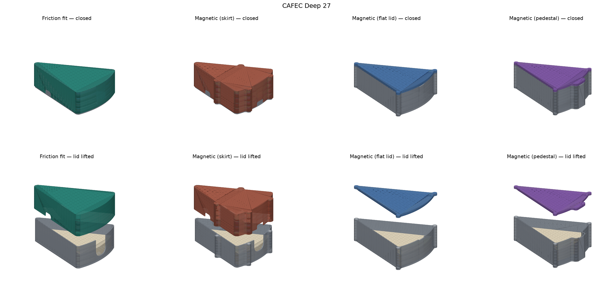
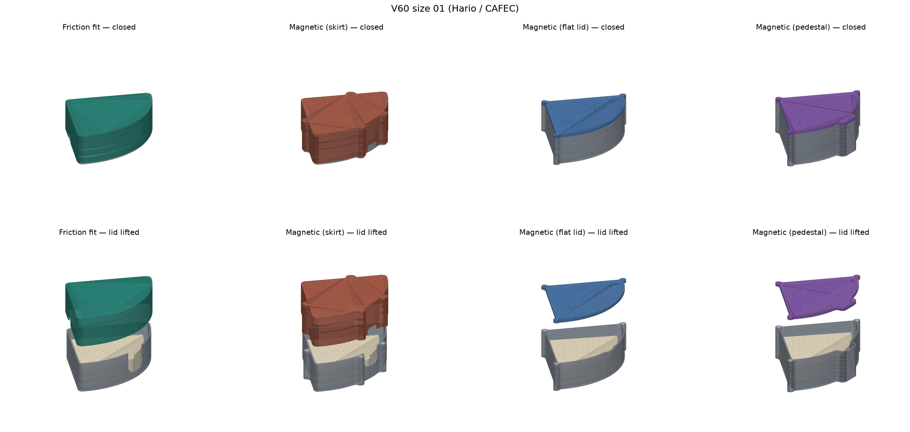
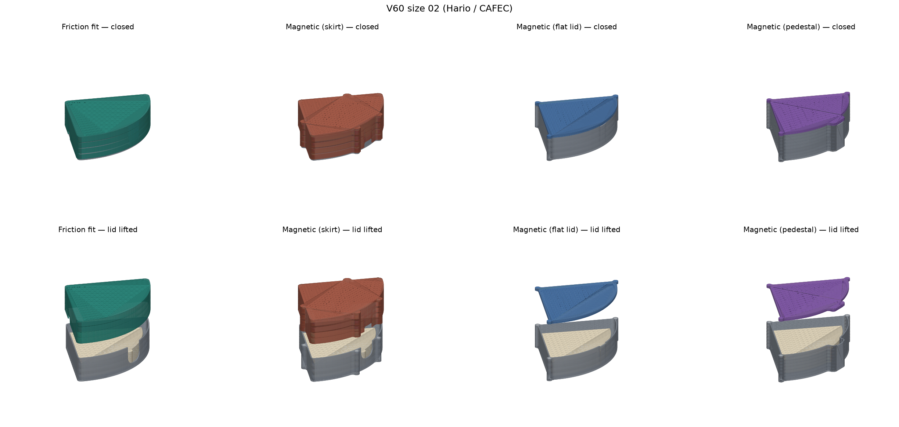

# Filtarr

3D-printable, dust-proof storage boxes for **pour-over paper filters** — currently
five papers (CAFEC Deep 27, Hario/CAFEC V60 sizes 01 & 02, and compact tabless CAFEC
cone variants) in four case designs, each with an optional engraved lid. Everything
is generated from one parametric Python script; adding a new paper is one registry
entry ([HOWTO](HOWTO.md)).

**Browse the interactive 3D previews and download STLs at
[ardakilic.github.io/filtarr](https://ardakilic.github.io/filtarr/).**

Open filter stands collect dust and kitchen odours; the original pouches are annoying
to use. Filtarr cases are two-piece wedge boxes: a tray that holds a full 100-pack
lying flat, plus a lid.


*CAFEC Deep 27 cases in all four designs — see the [gallery](#gallery) for the V60
variants.*

## Supported papers

| Paper | Flat geometry | Designs | Largest part |
|---|---|---|---|
| CAFEC Deep 27 (Abaca+) — [`deep27/`](deep27/) | 42° wedge, 155 mm side, no tab | all 4 | 182 × 142 mm |
| V60 size 01 (Hario / CAFEC) — [`v60/`](v60/) | 90° wedge, ≤107 mm seam edge + tab | all 4 | 140 × 187 mm |
| V60 size 02 (Hario / CAFEC) — [`v60/`](v60/) | 90° wedge, ≤128 mm seam edge + tab | all 4 | 162 × 219 mm |
| CAFEC cone cup 1, tabless — [`v60/`](v60/) | 90° wedge, 106 mm seam edge, no tab | all 4 | 133 × 177 mm |
| CAFEC cone cup 4, tabless — [`v60/`](v60/) | 90° wedge, 127 mm seam edge, no tab | all 4 | 154 × 207 mm |

The V60 boxes add radial clearance for the little **hanging tab** on the arc edge;
since its position varies by brand (Hario, CAFEC, generics), the whole interior is
enlarged radially — **one box fits all brands**. If you only use tabless CAFEC cone
papers, the dedicated `v60-cafec-*` cases are more compact (cup 4's friction design
fits a 200 mm bed where the all-brands V60-02 needs 220).

Every base holds a **full 100-pack lying loose, never squeezed** — interior depths
are sized per paper from measured stack heights: smooth Hario paper stacks ~32 mm
per 100, so those cases are 42 mm deep; creped CAFEC paper barely compresses (a
100-stack stays close to its 40–50 mm pouch thickness), so Deep 27 and cup 1 get
47 mm and cup 4 gets 54 mm, with headroom because papers fluff up once opened.
The pedestal design adds its 8 mm pedestal *on top* of these depths, so its box is
8 mm taller and the headroom is unchanged.
Tip: the crimped seam makes a stack lean taller on one side — flipping half the
papers upside down balances the pile (the wedge is symmetric).

## The four designs

| | Friction fit | Magnetic (skirt) | Magnetic (flat lid) | Magnetic (pedestal) |
|---|---|---|---|---|
| Lid style | full-cover telescoping lid | full-cover telescoping lid | flat lay-on lid, MAG-BOX style | flat lay-on lid, MAG-BOX style |
| Closure | snug fit (0.28 mm/side) | loose glide + 4 magnet pairs | 3 magnet pairs in the corners | 3 magnet pairs in the corners |
| Magnets needed | none | 8× Ø6 × 3 mm | 6× Ø6 × 3 mm | 6× Ø6 × 3 mm |
| Paper access | finger scoop in the wide-end wall | finger scoop in the wide-end wall (shorter — it rides above the thumb notch) | whole top opens; pry slot under the lid edge | finger bay + moat: pinch one sheet from under its edge |
| Opening grip | 2 side notches + 3 mm rim | 2 side notches **+ back thumb notch** — push its ledge up, the arc magnets peel first | pry slot under the lid edge, mid-arc | pry slot on the finger bay's face |
| Character | no hardware at all | most dust-proof magnetic option | simplest, lightest lid, one-hand open | easiest paper picking, 8 mm taller |

**Why the pedestal design?** With a flat lid the whole top opens, but sliding a single
sheet off a deep tray wall is fiddly — and papers with a hanging tab (Hario) make a
wall cutout unreliable. In the pedestal design the stack rests on an 8 mm pedestal
that stops 15 mm (plus the tab clearance) short of the arc wall, so every brand's
paper edge — tab included — overhangs a moat. A full-height finger bay bulges
*outward* mid-arc, keeping the rim closed and the box dust-proof, and lets you reach
under the overhanging edge and pinch out one sheet, down to the very last paper. The
interior is 8 mm deeper, so the 100-pack keeps its full never-squeezed headroom.

Shared features: finger scoop (telescoping designs), fully covered when closed —
reaching to 8 mm above the floor on the friction design, while the magnet-skirt
scoop is shorter, its bottom riding a 6 mm solid band above the back thumb notch.
Grip notches and a 3 mm exposed base rim let the telescoping halves separate: both
lids have one notch per straight side, and the magnet-skirt lid adds a 24 mm thumb
notch mid-arc — push its ramped ledge up until the arc magnet pair clicks free,
then lift (peeling one magnet pair at a time needs far less force than pulling all
four at once). An alignment lip on the flat lids so they can't slide sideways; no
supports needed in the exported print orientation.

## Gallery

**V60 size 01 (Hario / CAFEC)** — fits all brands, tab included —
[interactive preview](https://ardakilic.github.io/filtarr/v60/preview-01.html)



**V60 size 02 (Hario / CAFEC)** — fits all brands, tab included —
[interactive preview](https://ardakilic.github.io/filtarr/v60/preview-02.html)



**CAFEC cone cup 1, tabless** — compact —
[interactive preview](https://ardakilic.github.io/filtarr/v60/preview-cafec-01.html)


**CAFEC cone cup 4, tabless** — compact —
[interactive preview](https://ardakilic.github.io/filtarr/v60/preview-cafec-02.html)


## The "Filtarr" engraving

Every design has a second lid STL with **"Filtarr"** engraved 0.6 mm into the top face
(60 mm wide, Arial-style bold), upright when the tip of the wedge points at you. Text,
size, depth, font and position are parameters in `generate.py`.


## Interactive previews

Online at **[ardakilic.github.io/filtarr](https://ardakilic.github.io/filtarr/)**
(republished automatically on every push to `main`), or locally — each preview is a
fully self-contained HTML file (no internet needed), open in any browser:

- [`deep27/preview.html`](deep27/preview.html)
- [`v60/preview-01.html`](v60/preview-01.html)
- [`v60/preview-02.html`](v60/preview-02.html)
- [`v60/preview-cafec-01.html`](v60/preview-cafec-01.html)
- [`v60/preview-cafec-02.html`](v60/preview-cafec-02.html)

Switch between the designs, toggle the engraving, lift the lid with the slider, and
turn on X-ray or the ghost paper stack (which includes the V60 tab). The **"Print
these two"** panel always names the exact STL files (and magnet count) for what you're
looking at, the Dimensions panel lists the printer-fit tolerances, and "← All papers"
returns to the index.

## Files

Per design: 3 STLs (base + plain lid + engraved lid). Pick one base and one lid from
the same design:

```
<folder>/stl/<paper>-case-friction-{base,lid,lid-engraved}.stl
<folder>/stl/<paper>-case-magnet-skirt-{base,lid,lid-engraved}.stl
<folder>/stl/<paper>-case-magnet-flat-{base,lid,lid-engraved}.stl
<folder>/stl/<paper>-case-magnet-pedestal-{base,lid,lid-engraved}.stl
```

## Printing

- **Bed size**: see the supported-papers table — the "Largest part" is always the
  pedestal design (its finger bay adds ~12 mm in one axis). Deep 27 and CAFEC cup 1
  fit 180 × 180 mm beds, except the Deep 27 pedestal base at 182 mm; V60-01 needs
  ~190 mm in one axis (its friction design fits 180); CAFEC cup 4 needs ~200 mm
  (friction/skirt) to ~210 mm (flat/pedestal); the all-brands V60-02 needs a 220 mm
  bed.
- **Material**: PLA or PETG, 0.4 mm nozzle, 0.2 mm layers, 3 perimeters, 10–15 % infill.
- **Shell**: 2.0 mm walls and floor (5 perimeters / 10 layers with a 0.4 nozzle),
  2.0 mm friction lid, 1.6 mm telescoping lid skirts (a closed hoop, braced by the
  base wall when closed) — sized to be rigid, not bulletproof. The magnet lids
  measure 4.6 mm at the edge, but that's not solid plastic: 3.2 mm of it is the
  magnet pocket (leaving a 1.4 mm roof), and the underside is recessed to 2.0 mm
  everywhere except the sealing rim, lip and pockets — so they print ~45 % lighter
  than they look. Prefer other shells? `--wall-t` / `--floor-t` / `--skirt-t` are
  flags — see [Fit tuning](#fit-tuning).
- **Tolerances** (as designed, for a calibrated printer): friction lid **0.28 mm**
  clearance per side (snug snap fit); magnet-skirt lid **0.50 mm** per side (loose
  glide — the magnets do the holding); flat/pedestal lid alignment lip **0.5 mm**
  per side; magnet pockets **Ø6.4 × 3.2 mm** for Ø6 × 3 magnets (+0.4 mm diameter
  for glue, 0.2 mm recess so facing magnets never touch). Every preview repeats
  these in its Dimensions panel, and all of them are adjustable — see
  [Fit tuning](#fit-tuning).
- **Warping**: large flat parts — use a brim or good bed adhesion, especially PETG.
- No supports. Lids print top-face-down: smooth first-layer finish, crisp engraving,
  and magnet pockets become open blind holes.

### Fit tuning

Printers vary. Every fit tolerance is a command-line flag — no code editing — and
STLs, previews and index all regenerate consistently:

```bash
make generate GEN_ARGS="--clear-friction 0.32"
```

| Flag | Default | Controls |
|---|---|---|
| `--clear-friction` | 0.28 mm | friction lid clearance per side — tune in ±0.04 steps |
| `--clear-magnet` | 0.50 mm | magnet-skirt lid glide clearance per side |
| `--lip-clear` | 0.50 mm | flat/pedestal lid alignment-lip clearance per side |
| `--pocket-d` / `--pocket-depth` | 6.4 / 3.2 mm | magnet pockets (for Ø6 × 3 mm discs) |
| `--wall-t` / `--floor-t` | 2.0 / 2.0 mm | base shell thickness — 1.6 for ultralight, 2.4 for extra rigid |
| `--skirt-t` | 1.6 mm | telescoping lid skirt thickness |
| `--notch-w` / `--notch-h` | 22 / 10 mm | side grip notches on the telescoping lids (width / height above the 3 mm rim) |
| `--arc-notch-w` / `--arc-notch-h` | 24 / 10 mm | magnet-skirt back thumb notch — sized for a thumb (ANSUR anthropometry); widths that reach the arc magnet channels are rejected with the per-paper safe limit |
| `--arc-notch-gap` | 6.0 mm | solid wall band between the back notch top and the magnet-skirt scoop bottom (hard minimum 0.8 — the dust seal) |
| `--arc-notch-chamfer` | 1.0 mm | ramped ceiling of the back notch, so the thumb meets a slope instead of the 1.6 mm skirt edge; `0` = square |
| `--scoop-w` | 36 mm | finger scoop width (both telescoping designs) |
| `--scoop-above-floor` | 8 mm | friction scoop bottom above the interior floor (the magnet-skirt scoop derives from the back notch instead) |
| `--chamfer-bottom` | 2.0 mm | 45° chamfer at the pedestal's foot, in the moat — fades the shrink witness line on the base's underside (research says 1.5–3 mm is the useful range; it attenuates, not eliminates); `0` disables |
| `--chamfer-side-wall` | 1.2 mm | 45° cove where the pedestal top meets the side walls/apex — softens the section-change ring and the sharp interior corner; keep small (papers sit close to the walls near the tip); `0` disables |

Quick alternative if only the friction lid is too tight/loose: scale the **lid
only** by ∓0.2 % in XY in your slicer. Both magnetic closures are
tolerance-forgiving by design.

**Shell presets.** The shipped STLs use the defaults above. To regenerate the
original heavier, extra-rigid shells (as first published):

```bash
make generate GEN_ARGS="--wall-t 2.4 --floor-t 2.4 --skirt-t 2.0"
```

or an ultralight build (fine for a shelf queen, springier in the hand):

```bash
make generate GEN_ARGS="--wall-t 1.6 --floor-t 1.6"
```

(The lid plates aren't flagged: the friction plate is already minimal and the
magnet-lid thickness is dictated by the magnet pockets.)

## Magnet assembly (all magnetic designs)

Magnets: **Ø6 mm × 3 mm** discs (N35 or stronger) — 8 for the skirt design, 6 for the
flat and pedestal designs. Pockets are Ø6.4 × 3.2 mm, so each magnet sits ~0.2 mm
recessed — facing pairs never touch, giving a gentle snap that opens with one hand.

Get the polarity right on the first try:

1. Glue the base-side magnets into the **base** pockets (a drop of superglue or epoxy
   per pocket; press flush). Orientation of each individual magnet does not matter yet.
2. Once cured, place the remaining magnets **on top of the glued ones** — they snap on
   in the correct orientation by themselves.
3. Put a drop of glue in each **lid** pocket, align the lid, and press it fully closed.
   The loose magnets seat into the lid pockets in the right polarity. Let it cure
   closed (superglue: use sparingly — fumes can leave white residue; gel superglue or
   5-minute epoxy is cleaner).

## Regenerating / customizing

Everything runs inside Docker (`python:3-slim`) — no local Python needed, just
Docker and make:

```bash
make              # everything: STLs + previews + index + README images
make generate     # STLs + preview HTMLs + index.html
make docs         # README images (<folder>/docs/*.png)
make vendor       # fetch the latest three.js build (two files) into vendor/
make image        # (re)build the Docker build image only
make clean        # delete all generated outputs
```

(Without Docker: `pip install -r requirements.txt && python3 generate.py` works too.)

Add a new paper: see **[HOWTO.md](HOWTO.md)**. Useful shared knobs at the top of
`generate.py`:

| Parameter | Default | Meaning |
|---|---|---|
| `PAPERS` | 5 entries | the paper registry (side / angle / tab clearance / designs) |
| `DEPTH` / per-paper `depth` | 42 / 47 / 54 mm | interior depth — 42 default (Hario), deeper for creped CAFEC papers |
| `WALL_T` / `FLOOR_T` | 2.0 / 2.0 mm | base shell (also CLI flags — see [Fit tuning](#fit-tuning)) |
| `LID_T_FRICTION` / `LID_T_MAGNET` / `LID_CORE_T` | 2.0 / 4.6 / 2.0 mm | lid plates; magnet lids keep 4.6 only at rim & pockets, recessed to 2.0 elsewhere |
| `CLEAR_FRICTION` / `CLEAR_MAGNET` | 0.28 / 0.50 mm | lid clearance per side (also CLI flags — see [Fit tuning](#fit-tuning)) |
| `LIP_CLEAR` | 0.5 mm | flat/pedestal lid alignment-lip clearance (also a CLI flag) |
| `POCKET_D` / `POCKET_DEPTH` | 6.4 / 3.2 mm | magnet pocket (for Ø6 × 3 magnets; also CLI flags) |
| `ENGRAVE_TEXT` / `ENGRAVE_WIDTH` / `ENGRAVE_DEPTH` | "Filtarr" / 60 / 0.6 mm | lid engraving |
| `SCOOP_W` / `SCOOP_ABOVE_FLOOR` | 36 / 8 mm | finger scoop width / friction scoop bottom above the floor (both CLI flags) |
| `NOTCH_W` / `NOTCH_H` | 22 / 10 mm | side grip notches on the telescoping lids (CLI flags) |
| `ARC_NOTCH_W` / `ARC_NOTCH_H` / `ARC_NOTCH_GAP` | 24 / 10 / 6 mm | magnet-skirt back thumb notch + solid band to its (derived) scoop — all CLI flags, see [Fit tuning](#fit-tuning) |
| `PEDESTAL_H` / `MOAT_W` | 8 / 15 mm | pedestal design: pedestal height / moat width (+ tab clearance) |
| `PEDESTAL_CHAMFER_BOTTOM` / `PEDESTAL_CHAMFER_WALL` | 2.0 / 1.2 mm | pedestal foot chamfer / pedestal-top wall cove (both CLI flags; `0` disables) |
| `BAY_W` / `BAY_D` | 34 / 12 mm | pedestal design: finger bay opening width / outward depth |

The engraving font comes from `FONT_CANDIDATES`: Arial Bold where available, and
Liberation Sans Bold (the metric-compatible Arial substitute installed in the Docker
build image) otherwise.

## Paper geometry (verified)

- A cone dripper with full apex angle **A** uses paper that unrolls to a
  `360·sin(A/2)`° sector, folding flat into a `180·sin(A/2)`° wedge.
- **Deep 27**: 27° cone → **42° wedge** (photo-confirmed 42.7° ± 1°); side ~155 mm;
  arc wide end of R≈155 about the tip; ~8 mm crimped seam; no tab; sold as 100-packs
  in a 205 × 160 × 40 mm pouch → loose stack 30–40 mm
  ([CAFEC official](https://cafec-jp.com/products/deep27/)).
- **V60**: 60° cone → **90° wedge**. Size 02: Hario's official flat sheet spec is
  125 × 125 mm ([maker data](https://www.askul.co.jp/p/EK20953/)); independently
  measured up to 125 × 128 mm. Size 01: spec 100 × 100 mm, measured up to
  105 × 107 mm. Hario papers carry a **hanging tab** (~15 mm wide, protruding
  ~5–7 mm) on the arc edge next to the seam corner; CAFEC cone papers
  ([same footprint](https://thebasicbarista.com/en-us/products/cafec-abaca-filter-papers))
  have no tab; generic clones vary — the cases size for the largest case
  (Hario + tab), so all brands fit.
- **100-pack stack heights** (they drive the interior depths): a single ply
  measures 206–210 µm ([caliper data](https://coffeeadastra.com/2019/08/04/an-in-depth-analysis-of-coffee-filters-2/))
  and a folded filter is two plies. Smooth Hario paper nests: ~32 mm per 100
  (measured). CAFEC's one-sided crepe doesn't: a 100-stack stays near its pouch
  thickness — 40 mm for Deep 27 and cup 1, 50 mm for cup 4.

## Design notes & credits

Ideas borrowed from the V60 3D-printing community: closed boxes beat open stands for
dust/odour (r/pourover consensus), finger cutouts at the paper edge
([packydb's drawer tray](https://www.thingiverse.com/thing:4980450)), corner-magnet
flat lids (the classic MAG-BOX pattern), glued 6 mm disc magnets in recesses
([AeroPress filter holder](https://www.printables.com/model/814937-aeropress-filter-holder)),
and generous cavity margins — V60 boxes repeatedly needed scaling because paper sizes
vary between brands and batches. The pedestal design combines two tricks from
commercial cases: a minimal-contact floor that lets paper edges overhang (Hario's
[V60 paper stand](https://www.hario-usa.com/products/v60-paper-stand-white)) and a
closed-rim finger recess (Yamazaki's Tosca filter case). Possible future ideas: a
wall-mount plate, a slimmer 40-pack travel size.

## License

Dual-licensed:

- **Code** (generator, templates, tooling): [MIT](LICENSE)
- **Models & images** (STLs, previews, renders): [CC BY 4.0](LICENSE-MODELS) — use,
  share, sell and remix freely, but credit **Filtarr** with a link back when you
  redistribute the models.
